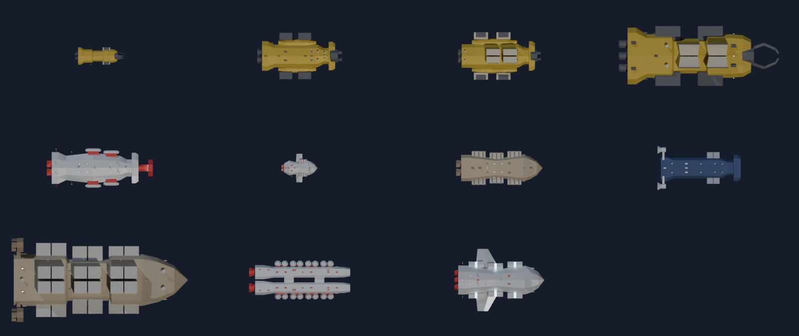
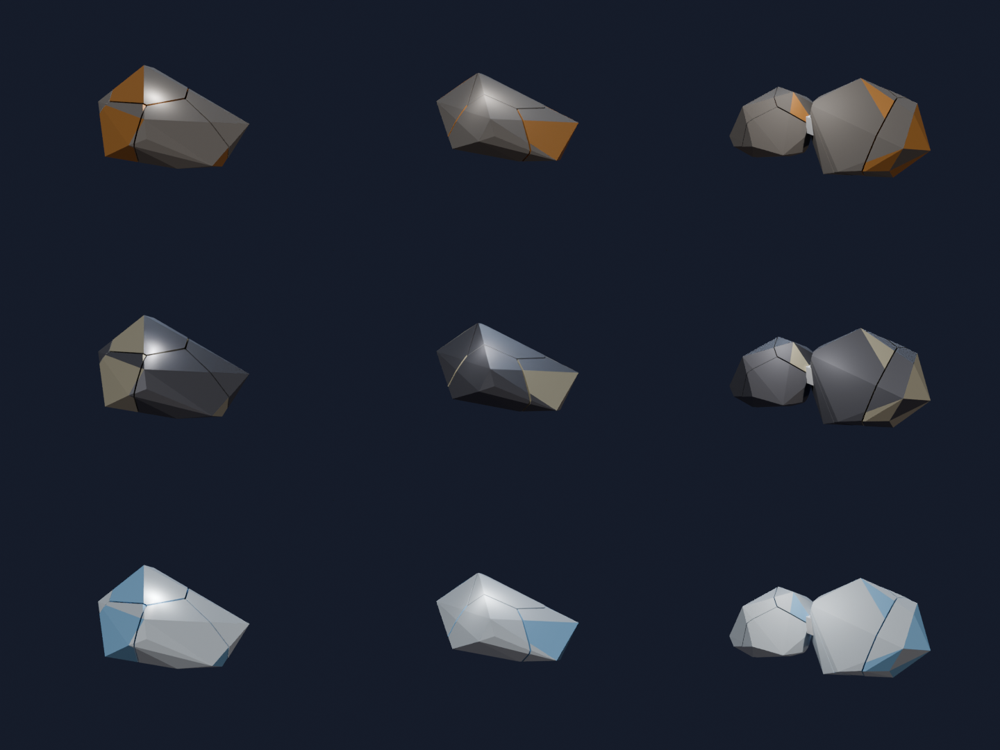

# ShipGen

Prozeduraler Low-Poly-Raumschiffgenerator für Blender, gebaut für ein Godot-Spiel über
Asteroidenbergbau, Fracht und Transport. Jedes Schiff entsteht aus einem Parameter-Satz
(z. B. einem Shop-Modell wie `miner_m`) plus einem Seed: Das Modell bestimmt die
**Werte**, der Seed das **Aussehen**.



- **Baukasten statt Rauschen:** Rümpfe aus entworfenen Sektionen (Heck, Mitte, Bug) und
  Bauplänen (Mono, Katamaran, Gabelbug), Anbauteile an Sockeln: 10 Triebwerke, 10 Bergbau-Rigs,
  10 Fracht-/Erz-/Tank-/Habitatmodule, Flügel, Greebles.
- **Passt immer:** Teile werden nur gleichmäßig skaliert, eine Kollisionsprüfung verhindert
  Überschneidungen (geprüft über alle 3840 Rumpf × Rig × Fracht-Kombinationen).
- **Werte aus der Geometrie:** Masse, Schub, Beschleunigung, Laderaum, Abbauleistung, Hülle –
  normiert, sodass Schiffe desselben Modells vergleichbar bleiben (±10 % Fertigungsstreuung).
- **Fertig für Godot:** `.glb` mit richtigen Achsen, Werten als Extras, Sockel-Nodes und
  konvexen Collision-Shapes.

## Schnellstart in Blender

Voraussetzung: **Blender 4.2 oder neuer** (entwickelt und getestet mit 5.x).

1. Extension bauen: `python3 scripts/build_extension.py` → `dist/shipgen-0.1.0.zip`
2. In Blender: *Edit → Preferences → Get Extensions →* Pfeil-Menü oben rechts →
   *Install from Disk…* → die Zip auswählen.
3. Im 3D-Viewport mit `N` die Seitenleiste öffnen, Reiter **ShipGen**:
   - **Load Parameters**: ein Preset aus `presets/` laden (z. B. `miner_m.json`)
   - **Generate Ship** / Pfeil-Knopf: bauen bzw. mit neuem Seed bauen
   - alle Parameter (siehe unten) sind direkt einstellbar; im Abschnitt **Kit** lassen sich
     Bauplan, Heck, Mitte, Bug und die Teile-Designs festlegen (`auto` / `-1` = Seed wählt)
   - **Copy Parameters**: aktuelle Einstellungen als JSON in die Zwischenablage
   - **Export .glb**: Schiff + Parameter-JSON in den Export-Ordner

## Kommandozeile

Die CLI läuft entweder mit einer Blender-Installation oder mit dem `bpy`-Modul aus PyPI
(Blender als Python-Paket, braucht Python 3.13):

```bash
scripts/setup_env.sh                                   # einmalig: .venv mit bpy 5.2
.venv/bin/python cli.py --preset miner_m               # oder:
blender -b -P cli.py -- --preset miner_m               # mit lokalem Blender
```

Pro Schiff entstehen in `output/` (bzw. `--out`): `<name>.glb`, `<name>.blend`,
`<name>.png` (Schrägansicht), `<name>_top.png` (Draufsicht) und `<name>.json`
(Modell, Parameter, Werte).

```bash
# 8 Exemplare eines Modells
.venv/bin/python cli.py --preset miner_m --seeds 1-8
# mehrere bzw. alle Presets, alle im selben Maßstab (64 m) gerendert
.venv/bin/python cli.py --preset all --frame 64 --no-blend --out output/lineup
# einzelne Parameter überschreiben
.venv/bin/python cli.py --preset hauler_m --set kit.plan=twin --set kit.engine_design=3
.venv/bin/python cli.py --preset miner_s --set mining.type=claw --set cargo.modules=4
# nur Modelle, kein Rendern (schnell)
.venv/bin/python cli.py --preset all --no-render --no-blend
# Werte-Tabelle aus den JSON-Dateien
python3 scripts/stats_table.py output/lineup/*.json
```

| Option | Bedeutung |
|---|---|
| `--preset NAME[,NAME…]` / `all` | Preset(s) aus `presets/` |
| `--params DATEI.json` | eigene Parameter-Datei |
| `--seed N`, `--seeds 1-20` | Seed bzw. Batch (`1,4,10-12`) |
| `--set pfad=wert` | Parameter überschreiben, mehrfach möglich |
| `--out ORDNER`, `--name NAME` | Ausgabeort / Dateiname |
| `--no-glb`, `--no-blend`, `--no-render` | Ausgaben abschalten |
| `--views three_quarter,top,rear` | welche Vorschaubilder |
| `--frame METER` | alle Schiffe im selben Maßstab rendern |
| `--resolution 960x540`, `--samples 16` | Vorschauqualität (Cycles, CPU) |
| `--strict` | abbrechen, wenn Parameter repariert werden mussten |

Die Ausgabe enthält pro Schiff eine Zeile `SHIPGEN_RESULT {…}` (JSON) für Skripte; der
Exit-Code ist bei Fehlern ungleich 0.

## Presets: die Shop-Modelle

| Linie | Modelle |
|---|---|
| Bergbau | `miner_s`, `miner_m`, `miner_m_hauler` (länger, Seitenkästen, mehr Erz, weniger Abbau), `miner_l`, `miner_gas` (Gas-/Eisschaufel, Tanks) |
| Fracht & Transport | `hauler_s`, `hauler_m`, `hauler_m_fast` (schneller, weniger Fracht), `hauler_l`, `tanker_m`, `liner_m` (Passagiere) |
| Kampf & Sonstiges | `fighter`, `interceptor`, `corvette`, `shuttle`, `freighter` |

Werte aller Modelle: [`docs/shop_stats.md`](docs/shop_stats.md). Ein neues Modell ist einfach
eine neue JSON-Datei in `presets/` – fehlende Werte werden mit Standardwerten aufgefüllt.

## Parameter

Alle Parameter werden validiert: falsche Typen, Werte außerhalb des Bereichs und unbekannte
Schlüssel werden repariert und als Warnung gemeldet (mit `--strict` als Fehler).

| Parameter | Bedeutung |
|---|---|
| `seed` | Aussehen des Exemplars (Bauplan, Designs, Streuung) |
| `class` | `fighter`, `interceptor`, `freighter`, `miner`, `corvette`, `shuttle` – bestimmt erlaubte Bausteine, Laderaumart, Panzerung |
| `hull.length`, `.width_ratio`, `.height_ratio` | Maße (Länge in m, Breite relativ zur Länge, Höhe relativ zur Breite) |
| `hull.squareness` | 0 = stark gefast, 1 = kastig |
| `engines.count`, `.size`, `.glow_color` | Triebwerke (Größe = Durchmesser in m) |
| `mining.type`, `.size` | `none`, `drill`, `laser`, `claw`, `scoop`; Größe 0–1 |
| `cargo.type`, `.modules`, `.size` | `none`, `containers` (Fracht), `hoppers` (Erz), `tanks` (Gas/Flüssig), `habitat` (Passagiere); Anzahl (paarweise); Größe 0–1 |
| `wings.type`, `.count`, `.span`, `.sweep_deg` | `none`, `delta`, `swept`, `straight`, `forward_swept`; 2 = Paar, 4 = X, ungerade = + Seitenleitwerk |
| `greeble_density` | Menge an Kleinteilen (nur Optik) |
| `style.palette`, `.wear` | Farbschema, Abnutzung |
| `kit.plan`, `.tail`, `.mid`, `.nose` | Bausteine festlegen (`auto` = Seed) |
| `kit.engine_design`, `.rig_design`, `.module_design` | Design 0–9 festlegen (`-1` = Seed) |
| `kit.detail` | Rumpfdetails 0–1: Rillen (alle Klassen), erhabene Seitenpaneele (Frachter, Miner, Korvette), Dachgraben (Frachter, Korvette); 0 = glatter Rumpf. Reine Optik |
| `spread` | Fertigungsstreuung pro Exemplar (Standard 0.025 ≈ ±10 % auf die Werte, 0 = exakt) |
| `max_tris` | Dreiecksbudget; notfalls fallen Module/Greebles weg (mit Warnung) |
| `builder` | `kit` (Standard) oder `classic` (alter Generator, nur zum Vergleich) |

Weitere Rumpfparameter (`segments`, `taper`, `nose_sharpness`, `variation`) und
`mining.count` wirken nur im `classic`-Generator.

## Werte

Die Werte entstehen aus der Geometrie (Einheiten physik-ähnlich, das Balancing passiert im
Spiel über eigene Faktoren):

| Wert | Herkunft |
|---|---|
| `mass_t` | Volumen der Teile × Dichte |
| `thrust_kn`, `acceleration_ms2`, `turn_rate_deg_s2` | leuchtende Düsenfläche, Masse, Länge |
| `hull_hp` | Rumpfoberfläche × Panzerung der Klasse |
| `cargo.general_m3` / `ore_m3` / `fluid_m3` / `passengers` | Modulvolumen + innerer Laderaum der Klasse |
| `mining.power`, `range_m` (+ `grab_size_m`, `intake_m2`) | Rig-Volumen, Reichweite ab Bug |

Damit der Seed nur das Aussehen ändert, kommen Rumpfwerte aus einem Referenzrumpf des Modells
und jedes Teile-Design ist auf den Mittelwert seiner Art normiert. Wie das funktioniert:
[`docs/parts_kit.md`](docs/parts_kit.md).

## In Godot verwenden

Die `.glb` ist auf Godot ausgerichtet (+Y oben, −Z vorne = Bug, +X rechts) und lässt sich
direkt importieren. Sie enthält:

- **Meshes nach Rolle:** `Ship_Hull`, `Ship_Engines`, `Ship_Mining`, `Ship_Cargo`,
  `Ship_Wings`, `Ship_Greebles` unter dem Node `Ship`.
- **Werte als Metadaten:** `Ship` trägt in den glTF-Extras `shipgen` = Seed, Klasse,
  Bauplan, verbaute Designs und alle Werte. Ob Godot glTF-Extras als Node-Metadaten
  übernimmt, hängt von der Godot-Version ab – sicher ist die `<name>.json`, die daneben
  liegt.
- **Sockel:** `Socket_engine_*`, `Socket_nose_*`, `Socket_side_*`, `Socket_top_*`,
  `Socket_wing_*`, `Socket_fin_*` – leere Nodes, deren Vorwärtsrichtung (−Z) in
  Sockelrichtung zeigt (Triebwerk nach hinten, Rig nach vorn). Für Effekte (Düsenflammen,
  Abbaustrahl) oder späteres Umrüsten.
- **Collision-Shapes:** `Col_*-convcolonly` – Godot macht daraus beim Import unsichtbare
  konvexe Formen (typisch 12–17 pro Schiff). Achtung: Godot legt sie als `StaticBody3D` an;
  für ein fliegendes Schiff die `CollisionShape3D`-Kinder unter den eigenen `RigidBody3D` /
  `CharacterBody3D` hängen (von Hand oder per Import-Skript).

## Asteroiden (Prototyp)

Asteroiden aus Erz, Metall oder Eis, vorgebrochen in konvexe Brocken bis zu einer
Mindestgröße – jeder Brocken ist in Godot direkt seine eigene Collision-Shape, Werte (Masse,
Ertrag, Härte) kommen wie bei den Schiffen aus der Geometrie.

```bash
.venv/bin/python cli.py --asteroid ore_m
.venv/bin/python cli.py --asteroid all --no-blend
```

Details, Hierarchie in Godot und Werte: [`docs/asteroids/README.md`](docs/asteroids/README.md).



## Entwicklung

```bash
scripts/setup_env.sh                                   # .venv mit bpy (Python 3.13)
.venv/bin/python -m unittest discover -s tests -t .    # alle Tests
.venv/bin/python scripts/kit_conflicts.py              # Kollisionsreport -> docs/kit/conflicts.md
.venv/bin/python scripts/kit_calibrate.py              # Abbauleistung neu kalibrieren
.venv/bin/python scripts/kit_demo.py --only parts      # Teile-Sheets -> docs/kit/
```

| Ordner | Inhalt |
|---|---|
| `shipgen/params.py` | Parameter-Schema und Validierung (ohne Blender nutzbar) |
| `shipgen/kit/` | Baukasten: Rumpfsektionen, Teile-Designs, Sockel, Kollisionen, Collider, Normierung |
| `shipgen/generator/` | gemeinsame Bausteine (Materialien, Grundformen, Flügel) und der `classic`-Generator |
| `shipgen/stats.py`, `export.py`, `ui.py` | Werte, Export/Vorschau, Blender-Panel |
| `cli.py`, `presets/`, `scripts/`, `tests/` | Kommandozeile, Shop-Modelle, Werkzeuge, Tests |
| `docs/` | Konzept (`parts_kit.md`), Werte-Tabelle, Render-Sheets |

Neue Teile-Designs müssen den Einheits-Vertrag im Docstring ihres Moduls einhalten
(Größe, Montage, Symmetrie); die Tests prüfen das für jedes Design auf jedem Rumpf.
Hinweise für die Arbeit mit Claude Code stehen in `CLAUDE.md`.
