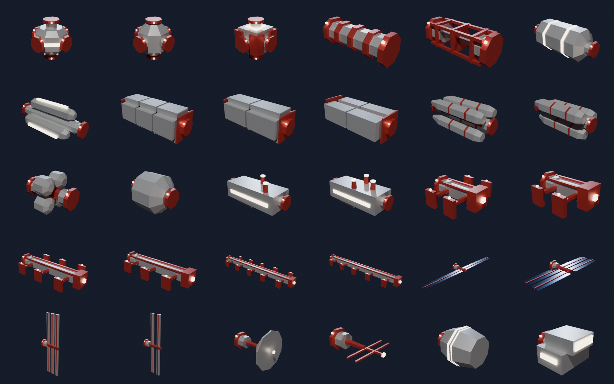
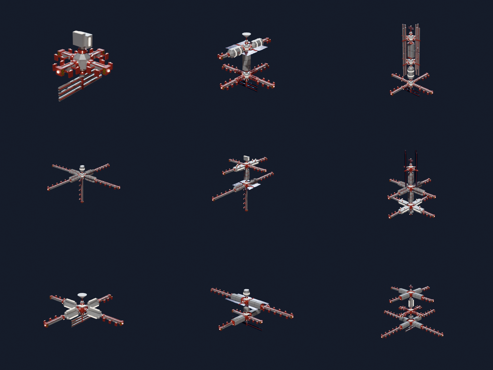
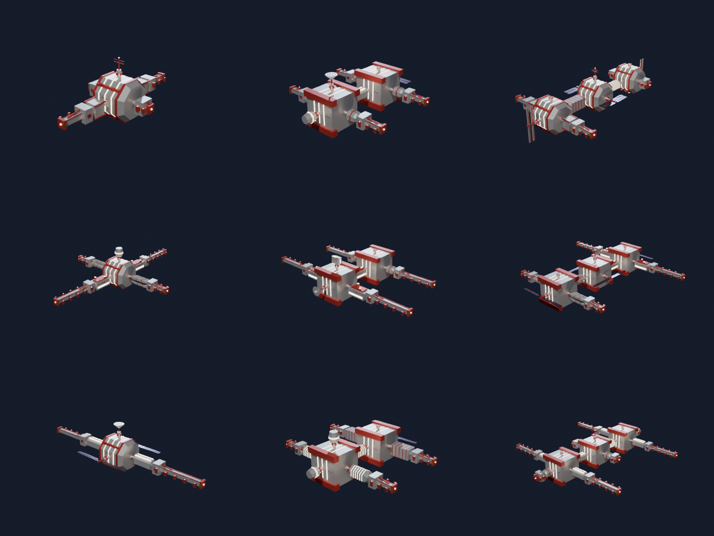
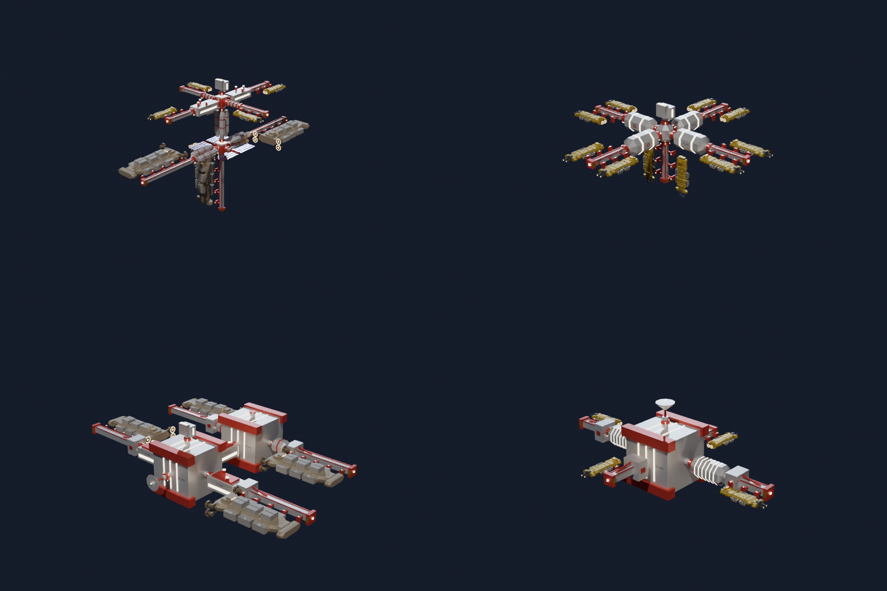

# Raumstationen – Modul-Baukasten (Prototyp)

Code: `shipgen/stations/` (`modules.py` = Baukasten und Vertrag, `__init__.py` = Layout,
Objekte, Werte), Presets: `presets/stations/`, Bilder: `scripts/station_demo.py`.

In Blender: Seitenleiste (N) → **ShipGen** → Bereich **Stations**: **Generate Station**,
**Build Module Kit** (alle Module einzeln, die Bibliothek fürs Spiel) und **Export .glb**
(exportiert, was gerade gebaut ist).

```bash
.venv/bin/python cli.py --station mining_m             # eine fertige Station
.venv/bin/python cli.py --station all --no-blend
.venv/bin/python cli.py --station-kit --no-render       # output/station_kit.glb: alle Module
```



## Der Vertrag (damit das Spiel selbst bauen kann)

- **Raster:** Würfelzellen von `GRID` = 16 m. Jedes Modul belegt ganze Zellen (`cells`,
  Zelle (0, 0, 0) zuerst) und bleibt darin.
- **Modul-Rahmen:** Ursprung = Mitte der Zelle (0, 0, 0), +Y = Hauptachse. Port 0 liegt
  immer auf der −Y-Seite von Zelle (0, 0, 0): jedes Modul kann an jeden freien Port.
- **Ports:** in der Mitte einer Zellseite, Flansch mit Radius 3.2 m, der genau auf der
  Zellseite endet. Zwei Module sind verbunden, wenn ihre Ports aufeinander liegen und
  gegeneinander zeigen. Im Export: Leer-Knoten `<Modul>_Port_<k>`, lokale +Y-Achse (Godot −Z)
  zeigt nach außen.
- **Reservierte Zellen** (`reserved`): bleiben frei – dort liegen angedockte Schiffe.
- **Liegeplätze** (Andockarme `dock_s/m/l`): Leer-Knoten `<Modul>_Berth_<k>` = wo der
  Ursprung des angedockten Schiffs hinkommt; lokale +Y = Bug, +Z = oben. Ein Schiffsknoten
  kann die Transformation des Liegeplatzes direkt übernehmen (Schiffe haben ihren Bug auf
  −Z, wie der Knoten). Größen: S bis 20 m, M bis 40 m, L bis 64 m Schiffslänge. Das Schiff
  liegt längs neben dem Pier, in der Nachbarspalte (L: den zwei nächsten), wie im Hafen.

| Art | Zellen | Ports | Funktion (Werte) |
|---|---|---|---|
| `hub` | 1 | 6 (alle Seiten) | Knoten |
| `corridor` | 1 | 2 | Verbindung (Röhre / offenes Gitter) |
| `habitat` | 2 | 2 | Crew (`crew`) |
| `storage` | 2 | 2 | Containerlager (`general_m3`) |
| `silo` | 2 | 2 | Erzsilos (`ore_m3`) |
| `tank` | 1 | 2 | Tanks (`fluid_m3`) |
| `refinery` | 2 | 2 | Erzverarbeitung (`refine_m3_h`) |
| `dock_s/m/l` | 1 / 2 / 4 | 1 | Pier mit 1–2 Liegeplätzen (`berths`) |
| `solar` | 3–5 quer | 1 | Strom (`power_kw`, aus der Paneelfläche) |
| `radiator` | 3 hoch | 1 | Kühlung (`cooling_kw`) |
| `antenna` | 1 | 1 | Antenne / Schüssel |
| `command` | 1 | 1 | Kommandomodul (`crew`) |
| **massiv:** | | | |
| `core` | 3 × 3 × 3 | 6 (Seitenmitten) | 48-m-Kern statt Hub (`crew`), Panzerung, Fensterdecks |
| `bulkhead` | 1 | 2 | dickes Verbindungssegment |
| `hall` | 2 | 2 | Lagerhalle, füllt die Zellen (`general_m3`) |
| `smelter` | 2 | 2 | Schmelzwerk (`refine_m3_h`) |
| `quarters` | 2 | 2 | Mannschaftsquartiere (`crew`) |
| `dock_heavy_s/m/l` | 1 / 2 / 4 | 1 | schwerer Pier mit Sockelblock und Streben (`berths`) |

Jede Art hat 2–3 Designs (gleicher Vertrag, anderes Aussehen). Werte kommen wie bei den
Schiffen aus der Geometrie (Volumen der Ladungs-Körper, Paneelfläche ...).
`tests/test_stations.py` prüft den Vertrag für jedes Design.

## Fertige Stationen



Zeilen: Außenposten, Mining, Handel; Spalten: small, medium, large.

- **Rückgrat:** 1–3 Hubs (`size`) übereinander, dazwischen ein Kernmodul der Rolle
  (Mining: Raffinerie/Silo/Tank; Handel: Lager/Habitat/Tank; Außenposten: Habitat/Lager).
- **Arme:** an jedem Hub symmetrisch – `four` = dieselbe Kette in alle vier Richtungen,
  `two` = zwei gegenüberliegende Paare mit je eigener Kette. Ketten kommen aus der Rolle
  (z. B. Mining `silo → dock_l`, `refinery → dock_m`, `solar`). Der erste Hub bekommt immer
  Andockarme. Ein Glied wird nur gesetzt, wenn es auf allen symmetrischen Kopien Platz hat
  (Zellen und Liegeplätze frei); sonst endet die Kette dort. Andockarme versuchen erst
  waagrechte Liegeplätze, dann gedrehte.
- **Enden:** oben Kommando/Antenne, unten Kühler/Tank/Solar/Andockarm.

### Massiv (`build = massive`)



3 × 3 × 3-Kerne (48 m) statt Hubs, Module, die ihre Zellen füllen (Halle, Schmelzwerk,
Quartiere, Schott), und schwere Andockarme. Die Kerne liegen **waagrecht nebeneinander**
(`spine = auto` → horizontal), alle Arme und Liegeplätze in derselben Ebene – gemacht für die
Draufsicht im Spiel: an jedem Kern ein Paar Arme quer zum Rückgrat (jeder zweite mit
Andockarmen), an den beiden Enden ein weiteres Paar (`four`) oder Endmodule (`two`), oben auf
dem mittleren Kern Antenne oder Kommando. `spine = horizontal` legt auch schlanke Stationen
flach, `spine = vertical` stapelt auch massive. Gleiches Raster und
gleiche Ports wie der schlanke Stil (`truss`, Standard) – beide Baukästen lassen sich mischen.
Die schlanken Stationen bleiben für jeden Seed genau wie bisher (die massiven Module ziehen ihre
Zufallszahlen aus einem eigenen Strom). Presets: `mining_m_massive`, `trade_l_massive`.



Zum Größenvergleich liegen hier Shop-Schiffe an den Liegeplätzen (`hauler_s`, `miner_m`,
`hauler_l`; nur im Demo-Bild, nicht im Export). Oben schlank, unten massiv.

## Offen

- Weitere Module (Hangar, Ringe, Werft), Andocken nach innen.
- Stationsstil pro Rolle (Farben), mehr Layout-Varianten (Ringe, schräge Arme).
- Freie Ports bleiben offen (Flansch sichtbar) – das Spiel kann dort anbauen.
