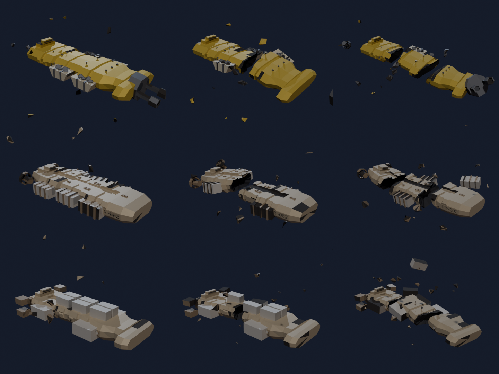

# Schiffswracks – Prototyp

Code: `shipgen/wrecks/` (Generator, Schema), Presets: `presets/wrecks/` (jedes nennt sein
Shop-Modell unter `"ship"`), Bild: `scripts/station_demo.py --only wrecks`.

In Blender: Seitenleiste (N) → **ShipGen** → Bereich **Wrecks**. **Wreck Ship** baut ein Wrack
des Schiffs, das oben im ShipGen-Bereich eingestellt ist – neben dem Schiff (eigene Collection
`ShipGen_Wreck`; Blender hängt an doppelte Namen `.001` an, der Export schreibt die reinen Namen).

```bash
.venv/bin/python cli.py --wreck miner_m_broken          # output/miner_m_broken_1{.glb,.blend,.png,.json}
.venv/bin/python cli.py --wreck all --no-blend
.venv/bin/python cli.py --wreck hauler_l_split --seeds 1-6 --set damage=0.9
```



Zeilen: `miner_m`, `hauler_m`, `hauler_l`; nach rechts steigen Schaden (0.3 / 0.6 / 0.9) und
Brüche (0 / 1 / 2).

## Aufbau

Ein Wrack ist ein echtes Shop-Modell (Kit-Builder, Seed `ship_seed`, sonst `seed`): Spieler
erkennen, was es war, und die Teile sind dieselben wie im Shop.

- **Brüche** (`breaks` 0–3): geneigte Ebenen schneiden Rumpf und Greebles in Segmente
  `Hull_<k>`. Die Bruchkante ist ausgefranst (Kantenpunkte entlang der Oberfläche
  zurückversetzt), das offene Ende bekommt einen dunklen, nach innen gewölbten Deckel
  (Material `Wreck_Inside`). Das größte Segment bleibt liegen, die anderen treiben von ihrem
  Bruch weg und drehen sich (`spread`).
- **Löcher** (`holes`): große Rumpfflächen werden eingesetzt und nach innen gedrückt –
  nie tiefer als ein Drittel der Wandstärke dort (Strahl zur Gegenseite), damit dünne Rümpfe
  nicht durchstoßen.
- **Brandspuren** (`burn`): Flächen an Bruchkanten, Löchern und zufällig verteilt werden
  `Wreck_Burnt`; alle Glow-Flächen (Düsen, Brückenfenster) sind erloschen (`Wreck_Dead`).
  Der Lack ist abgenutzt (`style.wear` mindestens 0.5 + 0.5 × `damage`).
- **Teile** behalten Namen und `shipgen_part` und bekommen einen Zustand (`damage` steuert die
  Anteile):
  - `intact` – sitzt auf seinem Segment, Zustand 0.85–1,
  - `damaged` – sitzt schief auf seinem Segment, angesengt, Zustand 0.3–0.7,
  - `detached` – abgerissen, treibt taumelnd neben dem Wrack, Zustand 0.4–0.9,
  - `destroyed` – weg; 1–3 geschrumpfte Splitter (`Debris_<i>`) fliegen davon.
  Ein Teil, das über einem Bruch saß, ist immer zerstört.
- **Trümmer** (`debris`): zusätzliche dünne Rumpfplatten um die Bruchstellen.

## Werte (für Bergung)

- Pro Teil (`shipgen_salvage`): Zustand, `condition` (0–1), `mass_t` (Volumen × Dichte der
  Rolle wie beim Schiff). Was das Teil wert ist, entscheidet das Spiel (Design und Art stehen in
  `shipgen_part`).
- Pro Segment (`wreck_segment`): Volumen, Schrottmasse, `anchor` (das liegengebliebene).
- Pro Splitter (`wreck_debris`): Herkunft (`hull` oder Teilname), Volumen, Masse.
- Gesamt (`Wreck.extras.shipgen_wreck.stats`): das Schiff (Klasse, Design, Ausstattung),
  Anzahl Segmente/Trümmer, Teile pro Zustand, Liste aller Teile mit Zustand, Bergungs- und
  Schrottmasse.

## Collider

Jedes Segment hat die konvexen Rumpfstücke des Schiffs, an den Bruchebenen abgeschnitten
(`Hull_<k>_col_<j>-convcolonly`; konvex ∩ Halbraum bleibt konvex). Bruchkanten, Deckel und
Löcher gehen nur nach innen, die Collider decken das Segment also weiter ab
(`tests/test_wrecks.py` prüft das). Teile behalten ihren Collider, Splitter haben die exakte
Hülle ihrer Punkte.

## Offen

- Andere Schiffstypen (alte/fremde Designs) – bisher nur Shop-Modelle.
- Zerlegbar (wie die Asteroiden) ist ein Wrack bewusst nicht.
